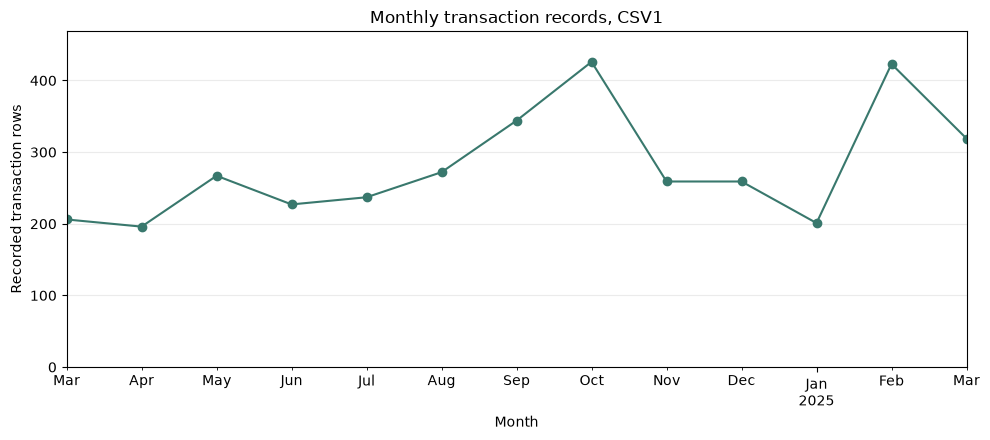
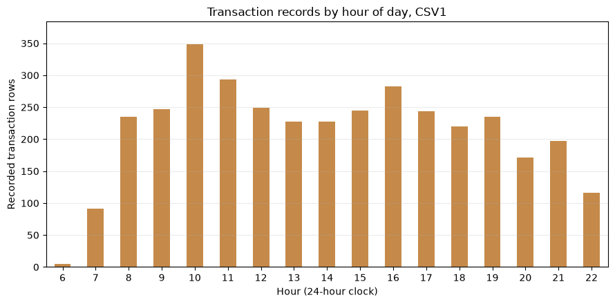

## 1. Dataset and decision-maker

This project uses **CSV1 (`index_1.csv`) only** from the Kaggle [Coffee Sales dataset](https://www.kaggle.com/datasets/ihelon/coffee-sales) by Yaroslav Isaienkov. The dataset page describes sales from a coffee vending machine, collected from March 2024 onward. The dataset page describes these as sales transactions from a coffee vending machine; the source does not provide enough machine-operating metadata to independently audit collection completeness. CSV1 contains **3,636 transaction records** from **March 1, 2024 through March 23, 2025**, covering eight drink names. The source page lists the dataset as CC0: Public Domain. Keep the provided `index_1.csv` in this project folder next to `app.py`; commit that CSV with the app so the GitHub deployment can read it. The project uses no other CSV.

The observation unit is one recorded transaction row. The decision-maker is the **operator responsible for this vending machine**. The dashboard supports scheduling routine machine checks based on recorded activity by hour and changes in weekly activity.

## 2. Why a dashboard?

The operator revisits the same questions: how much activity was recorded, when activity is concentrated, and whether the recent pattern has changed. A dashboard supports repeated date-range and drink-specific checks. A weekly email or one-time report could summarize a fixed snapshot, but would not let the operator change the period or focus on one drink while investigating a shift. A single alert would flag a threshold without showing the hourly context. The dashboard supports that repeated exploration; an alert could complement it for urgent changes.

The main decision statement is: **If the operator sees the recorded transaction peak around 10:00, they schedule a routine replenishment check before the morning peak.** A second monitoring rule is: **if a complete week's transaction-record count is at least 20% below its preceding eight-week average, the operator checks machine uptime and data capture before changing the replenishment schedule.** The app displays this as a review prompt when the selected history contains enough weeks. The 20% threshold is a proposed starting rule, not a result established by the snapshot; it should be calibrated against operational logs.

Without a dashboard, the operator would group transaction rows manually by date, drink, and time. The time saved has not been measured, so this project does not claim a quantified cost reduction. A stale weekly view could delay noticing a machine or data-capture problem until the next review; the dataset does not contain uptime or inventory records, so the financial cost of that delay cannot be estimated here.

## 3. What the EDA says and what the dashboard shows

The companion notebook is [`coffee_sales_eda.ipynb`](coffee_sales_eda.ipynb). It checks data types, missing values, duplicate rows, date coverage, sales by drink, and time patterns. Its charts are saved in `assets/eda/` for this README; rerun the notebook cells to regenerate them.





The drink-level sales comparison is available in [`assets/eda/drink_sales.png`](assets/eda/drink_sales.png); it was reviewed during EDA but left off the operational dashboard to keep its focus on timing.

| Dashboard element | Reason for inclusion |
|---|---|
| Transaction-record count | Shows the scale of recorded activity in the selected period. |
| Average records per day with records | Shows typical observed activity on dates with at least one matching row. |
| Recorded sales amount | Adds financial context; the value is shown in source units because the currency is undocumented. |
| Weekly transaction trend | Shows whether recorded activity is changing over time. |
| Transactions by hour | Helps identify a time for a pre-peak machine check. |
| Date range and drink filters | Let the operator focus on a period or a drink they are reviewing. |

The EDA also compares recorded sales by drink. The app leaves that ranking off because this dashboard focuses on **when** to check the machine; the weekly trend and hourly view take priority. The drink filter remains available for a focused check on one item.

In CSV1, Latte has the highest recorded sales amount (**27,866.30 source units**), while Americano with Milk has the highest transaction count (**824 records**). The busiest recorded hour is **10:00**, with **349 records**. The source does not specify a currency, so the dashboard labels amounts in source units.

The dashboard omits customer-level analysis because the card identifier is not needed for replenishment timing and is missing for 89 rows. It also omits profit, stockout, and exact reorder recommendations because the file contains no costs, inventory levels, or stockout records. A transaction count is not the same as units sold: the CSV does not include item quantity.

## 4. Data limitations and refresh plan

- The CSV has 381 observed dates across a 388-day span. Seven calendar dates have no transaction rows. The source does not establish whether those dates had no sales or whether data collection was incomplete.
- March 2025 is partial and ends on March 23, so it should not be compared with complete months as though it were a full month.
- The amount field is named `money`, but its currency is not documented.
- The data has no inventory, stockout, waste, operating-hours, or cost fields. The dashboard can show recorded activity, but it cannot measure lost demand or calculate an optimal reorder quantity.
- This is a historical Kaggle snapshot, not a live feed. A production version should refresh nightly from the vending-machine sales log; the operator could review it weekly before planning replenishment. This cadence matches weekly planning while retaining the ability to examine recent changes.
- The proposed operational review trigger is a complete week whose recorded transaction count is at least 20% below the preceding eight-week average. It prompts an uptime and data-capture check; it does not prove that customer demand fell. Tune it against operational logs before use.

## 5. Page order

The page starts with its audience and decision, then states the data period and proposed production cadence. Three metric cards provide the overall scale. The complete-week trend follows to show comparable week-to-week movement, and the hourly chart follows to support timing decisions. Partial weeks at the selected date boundaries are excluded from the weekly trend and alert calculation. Filters sit in the sidebar so they do not compete with the first-screen summary. Caveats remain visible beside the charts because missing dates and absent stock records affect interpretation.

## Run locally

Use the shared Python environment in the course `ml4biz` folder. Keep `index_1.csv` next to `app.py`; in the VS Code terminal run:

```powershell
cd "C:\Users\Jammie\ml4biz"
uv run streamlit run "labs\week6-2-coffee app\app.py"
```

Open `coffee_sales_eda.ipynb` in VS Code and select the existing `ml4biz` Python environment as the notebook kernel. The notebook reads `index_1.csv` from the same folder as the notebook.

## Deploy

1. Publish this project folder as a **public GitHub repository** under your own account. Include `app.py`, `index_1.csv`, `coffee_sales_eda.ipynb`, `README.md`, `requirements.txt`, and the README chart assets.
2. In Streamlit Community Cloud, create an app from that repository and set the main file to `app.py`.
3. In **Advanced settings**, choose Python **3.14**, then deploy.
4. Check the deployed app and submit its URL plus the public repository URL in Canvas.
